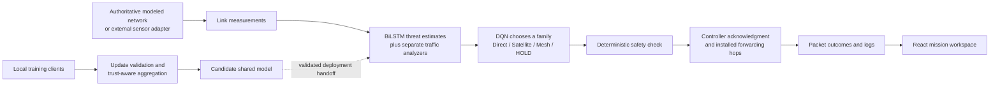

# FLARE final panel review — start here

Prepared from the current source tree and fresh local executions on **21 October 2026**. This is a speaking and demonstration pack. It is not a claim that the entire application, all research branches, or real drone networking has passed validation.

Read in this order:

1. [Presentation](presentation/output/FLARE-panel-review.pptx): ten editable slides with speaker notes. [Separate speaking script](presentation/output/FLARE-speaker-script.md).
2. This file: understand the story and rehearse the three scripts.
3. [Exact demo runbook](DEMO.md): the 5–7 minute route, extended options, setup and recovery.
4. [Results and evidence](RESULTS.md): numbers you may quote, their meaning and their boundaries.
5. [Panel questions](QUESTIONS.md): 45 questions with short answers and optional depth.
6. [Review-day card](REVIEW_DAY.md): compact reminders to keep beside the laptop.

The core route and an extended route passed again against a fresh isolated production build. The extended execution verified recorded-packet replay, 3D/camera/layer controls, a paused altitude command followed by acknowledgment, synchronized A/B with cancellation, and a small all-ten benchmark with complete JSON export. See [the rehearsal record](evidence/final-rehearsal/extended-result.json). These targeted results do not erase the unresolved broad-audit failures described in the results guide.

Your individual contribution cannot be inferred reliably from the repository. [Your contribution](CONTRIBUTION.md) provides complete speaking options for the actual module roles. Choose only the option that matches your work and credit teammates accurately.

The shortest useful message is: **“FLARE observes communication conditions, estimates risk, chooses a safer communication option, checks that choice, and records what the controller actually applied. It also protects the collaborative model from suspicious updates.”**

## 1. What the project is

FLARE stands for **Federated Learning and Adaptive Rerouting Engine**. It is a research prototype for studying how a UAV network can keep communicating when links deteriorate or participants behave maliciously.

Imagine several drones inspecting a disaster area. A drone may reach ground control through its own radio, a modeled satellite connection, or neighboring drones. Interference can make one option unreliable. A compromised participant can also lie about traffic or submit a harmful training update. FLARE brings observation, threat assessment, communication policy, safety checks and enforcement evidence into one workflow.

The current demonstration uses **software UAVs and modeled packets**. The drones, movement commands and antenna scenery are not physical flight control. The local SDN backend applies logical rules inside the simulator; it does not establish real OpenFlow forwarding or radio performance.

### Why it matters

A fixed route can continue using a damaged link. Choosing only the lowest apparent threat can ignore delay, loss, switching cost and compromised relays. Simply averaging all training updates can let a malicious participant distort the shared detector. FLARE studies those problems together.

Applications that motivate the work include search and rescue, infrastructure inspection, environmental monitoring and temporary communications. These are intended applications, not deployments already completed by this project.

### What is different about our approach

The contribution is the **integration and evidence trail**: communication measurements, federated detection, traffic-security observations, trust-aware update analysis, adaptive route-family selection, deterministic safety and separately confirmed forwarding. A reproducible topology laboratory lets us investigate network structure without mixing it with learned-policy changes.

Do not claim we invented federated learning, BiLSTM, DQN, trust weighting or SDN, or that no prior system combines them. No fresh systematic literature comparison was performed for this preparation.

## 2. Explain the architecture simply

The arrows describe responsibilities, not a guarantee that every service is currently available. Model training and live inference are separate processes. A newly trained candidate does **not** automatically replace the deployed checkpoint merely because a round finished.

### The five application destinations

| Page | What it contributes | What to explain if opened |
|---|---|---|
| Overview | Connection/controller health, network charts and decision evidence | Read the selected UAV, measured family, freshness and model source before interpreting a graph. Missing values are not observed zeroes. |
| Mission | Live execution, inspection, commands, attacks, probes and isolated topology experiments | The simulator is authoritative. An experiment uses a reference policy; the live mission can use the deployed detector/DQN workflow. |
| Fleet | Enrollment and configuration, active/disabled filtering, local detail drawers | Editing requires permission and validation. Local Fleet selection changes Mission inspection only through **Inspect in Mission**. |
| Security | Policy settings and federation monitoring | **Save safeguards** is explicit. Some settings require FL service restart, and advanced research settings still have live-effect gaps. A saved checkbox alone is not runtime evidence. |
| Validation | Controlled traffic response and copied-model update protection | Traffic Evidence changes a selected simulated UAV. FL Update Gate works on copies and preserves the deployed model. Both show actual failures or unavailable evidence. |

Global **Activity** preserves timestamped logs and technical details. **Export report** downloads the existing evaluation HTML report. **Lock** ends the current authenticated interface session. Navigation keeps the Mission component mounted, so going to another page is not a simulation reset. The interface and API authentication are prototype controls, not a production security certification.

| Component | What it does | Why it is needed | A simple explanation |
|---|---|---|---|
| Authoritative Python simulator | Owns positions, links, packets, time, attacks and outcomes | Keeps the interface consistent with one execution state | The laboratory, not an animation that invents results |
| Radio and topology engine | Checks physical link eligibility, then topology rules | A desired connection still needs a viable modeled radio link | A seating plan cannot make two distant radios hear each other |
| Event packet scheduler | Records queues, transmission attempts, arrival, loss, retry and expiry | Lets latency and delivery come from packet execution | A delivery log with precise handoff times |
| BiLSTM with attention | Uses recent sequences of five communication measurements to estimate threats | A changing pattern can be more informative than one reading | A monitor reading a short history, not one photograph |
| Traffic/security analyzers | Score available forwarding, rate, identity and replay evidence | Model-update poisoning and network misconduct are different problems | An independent set of traffic checks; not the RF model |
| Flower clients/server | Train locally, exchange parameters, aggregate and save candidates | Explores learning across participants without pooling all their raw windows | Several students share what they learned rather than all their notebooks |
| Update analyzer and trust | Compare update norms, directions, deviations and history; reject or reduce influence | A harmful contributor should not count equally | Do not give an unreliable witness the same influence as corroborated evidence |
| DQN policy | Chooses a communication family using learned utility | Balances competing costs rather than one measurement | A dispatcher choosing an option, not drawing every road |
| Safety gate | Constrains unsafe proposals and may require HOLD | Learned proposals need executable safety rules | A final permission check before dispatch |
| Network routing and SDN adapter | Compute feasible hops and apply forwarding/containment | A proposed family is not an installed path | The dispatcher chooses “road”; the network finds and permits the streets |
| FastAPI and streams | Authenticate requests and deliver state/events | Connect the operator to real backend actions | The controlled communication desk between UI and engine |
| React, TypeScript and Three.js | Present 2D/3D networks, evidence, commands and experiments | Make cause, state and uncertainty inspectable | Two views of the same laboratory |
| SQLite and exports | Store decision history and produce reports/traces | Support investigation and reproduction | The experiment notebook |

### The five measurements

- **RSSI:** received signal strength; a stronger signal alone does not guarantee good delivery.
- **PDR:** packet delivery ratio; how many offered packets arrived.
- **SINR:** useful signal compared with interference and noise.
- **Latency:** how long delivery took.
- **Packet loss:** the fraction that did not arrive within the applicable measurement definition.

The model has communication-threat outputs, an attack-class head and a confidence head. Its modeled profile names do not mean it has a validated classifier for every Attack Lab profile. GPS spoofing, replay, traffic flooding and poisoned model updates have separate simulation/evidence paths.

### The three decisions you must keep separate

1. **Policy family:** what DQN proposed: Direct, Satellite, Mesh or v3 HOLD.
2. **Safety/request:** what was permitted and requested after constraints.
3. **Installed forwarding:** what the controller confirmed, including actual computed hops.

A line highlight shows a network or forwarding relationship. It is not proof that a packet arrived. Use a probe result or packet trace for delivery evidence.

## 3. A complete working example

> “A UAV is sending observations to ground control. We record the quality of the available communication options. The threat model estimates their risk from recent measurements. The routing policy proposes an option, and the safety gate checks it. The network computes the permitted hops and the controller reports whether it applied them. Packets then either arrive, fail or expire, and the interface shows those outcomes. If we inject a Direct jam, that changes the modeled channel condition; it does not directly write ‘attack detected’ into the detector. If another safe route is already installed, keeping it is a valid response. Separately, if a training participant submits a harmful update, aggregation can reject that update without treating it as an RF jam.”

The current v3 checkpoint supports four actions and an 18-value observation. The retained v2 contract has three route actions and a 14-value observation. Explain the version shown by runtime evidence; the older v2 fallback is configured for a least-risk degraded option when all three routes exceed threshold, while v3 supports executable network HOLD. **Do not promise every checkpoint behaves identically.**

## 4. A 30-second introduction

> “FLARE means Federated Learning and Adaptive Rerouting Engine. It is a research prototype for keeping UAV networks communicating when links degrade or participants become untrustworthy. It combines collaborative threat learning with adaptive communication choices and safety checks. I’ll demonstrate modeled packet delivery and confirmed forwarding in our simulator. The aim is an inspectable resilience workflow. Physical drone validation remains future work.”

Aim for clear delivery rather than speed. Say “software packet simulator” before showing attacks.

## 5. A two-minute explanation

> “Our project addresses two related risks in a drone network. First, interference or poor link quality can interrupt communication. Second, a compromised participant can damage the shared learning model or provide misleading traffic information.
>
> FLARE handles this as an observe, decide and verify process. We collect five communication measurements: signal strength, delivery ratio, signal-to-interference ratio, delay and loss. A BiLSTM model reads their recent history and estimates communication risk. Separate analyzers examine available traffic and identity evidence.
>
> A DQN policy then chooses between Direct, Satellite, Mesh and, with our current v3 contract, HOLD. A deterministic safety check can constrain that proposal. The network engine computes feasible hops, and the controller must confirm the applied forwarding state. We show the proposal and the confirmed result separately.
>
> Federated learning supports the detector: participants train locally and exchange parameters. The server checks update consistency and historical trust, so a harmful update can be rejected or given less influence. Training produces a candidate; deployment is a separate validated step.
>
> The Mission Workspace lets us observe this process in 2D and 3D, send packet probes, inject bounded conditions and inspect decisions. Its topology comparisons use a fixed mesh reference policy so that changing topology does not also change the learning algorithm.
>
> Our evidence is primarily controlled simulation. We have functional regressions, seeded comparisons and bounded real training runs, but we cannot infer field accuracy from them. The next step is representative radio data, calibration and independently measured wireless and hardware tests.”

## 6. A five-minute presentation script

Approximate timings assume a natural pace with short pauses. The ten sections below form one continuous talk; do not read the headings aloud.

### 0:00–0:25 — introduction and motivation

> “FLARE stands for Federated Learning and Adaptive Rerouting Engine. We built a research prototype to study resilient communication in UAV networks. Imagine drones inspecting an area where communication conditions change during a mission. Useful sensing is much less useful if the observations cannot reach the operator.”

### 0:25–0:50 — problem statement

> “We focus on two failure paths. A link may become unreliable because of interference or poor signal conditions. A participant may also behave maliciously, either in network traffic or by submitting a harmful model update. Maintaining a connection and deciding whom to trust are related, but they need different evidence.”

### 0:50–1:15 — existing approaches and limitations

> “A fixed route cannot adapt well when its link changes. A simple lowest-risk rule ignores other costs such as delay and frequent switching. Ordinary federated averaging can give a harmful update too much influence. We use these as comparison points, without claiming that every existing system has those limitations.”

### 1:15–1:40 — proposed solution

> “Our solution connects observation, threat assessment, adaptive policy, a safety check and confirmed forwarding. The point is not only to choose a route, but to make the result inspectable. An injected condition, a detector observation and a controller acknowledgment are displayed as different facts.”

### 1:40–2:10 — overall architecture

> “The Python simulator owns network state and packet execution. FastAPI connects it to the React workspace. The detector and routing policy run in an orchestration loop, while Flower manages collaborative training. The interface offers a clear 2D network view and a 3D view of the same state. The scenery helps orientation; it is not additional experimental evidence.”

### 2:10–2:45 — major modules

> “The threat model reads sequences of signal strength, delivery, interference, delay and loss. DQN chooses a communication family. The network engine separately calculates its hops. Safety rules can override a proposal or suspend data forwarding with HOLD. For learning security, the aggregation server examines update direction, size, deviation and historical trust before accepting an update.”

### 2:45–3:20 — working example

> “Suppose Direct communication is disrupted. We inject a time-limited channel condition and then inspect measured impairment. The model may increase its risk estimate; the policy may use Satellite or Mesh if permitted. If it already uses a safe alternative, staying there is sensible. We confirm the installed state and use packet outcomes to check delivery. We never force a detector label merely to make the demonstration look successful.”

### 3:20–3:50 — features and contribution

> “The workspace includes ten topologies, packet probes, replay and synchronized comparisons. Topology and flight formation are independent: changing a ring into a tree changes allowed connections, not drone coordinates. A/B experiments use shared inputs and a deterministic mesh reference policy, keeping that question separate from live FL and DQN behavior.”

### 3:50–4:30 — results and observations

> “Our five-hop rehearsal probe delivered in about 48 milliseconds of simulation time. In one seeded topology benchmark, Full Mesh delivered 96 percent of its measured packet cohort, while Partial Mesh delivered about 99.88 percent with higher average latency. This illustrates a trade-off, not a universal winner. A separate synthetic routing check gave the retained v2 DQN a higher utility score than static Direct and lowest-threat routing, but it was close to a myopic reward baseline. These results use different protocols and must not be combined into one accuracy figure.”

### 4:30–5:00 — conclusion, limitations and next steps

> “FLARE demonstrates an end-to-end, inspectable resilience workflow in controlled simulation. We do not claim physical drone validation or representative field accuracy. Important next steps are better radio data, confidence calibration and real packet-enforcement and wireless tests. Some advanced federation settings are still research utilities rather than effective live behaviors. The central result is that we can configure a condition, observe evidence, inspect the policy and verify what was actually applied.”

## 7. What to showcase, in priority order

1. **A real five-hop probe and recorded outcome** — stronger evidence than moving dots.
2. **A bounded attack with simulation-time expiry** — pause freezes it; expiry ends the injected condition.
3. **Detection → Policy → Safety → Controller** — show where the evidence stops if a service is unavailable.
4. **The isolated FL Update Gate** — a safe, fast demonstration of update protection on copies.
5. **Topology switching without repositioning** — separates networking from formation.
6. **Synchronized A/B experiments and export provenance** — explains fair research comparison.
7. **Commands queued while paused and separately acknowledged** — shows operational semantics.
8. **3D terrain and visual layers** — useful context after establishing scientific meaning.

Do not spend most of the review rotating the terrain or reading raw JSON. Use technical details only if asked.

## 8. Technology choices: one sentence each

- **Python 3.11:** practical integration of simulation, numerical tools, models and services.
- **PyTorch:** flexible multi-head sequence model and local training.
- **BiLSTM with attention:** explores recent temporal patterns and their relative contribution; bidirectionality is within the observed window, not access to future mission telemetry.
- **Flower:** existing federated parameter-exchange and round coordination rather than a custom training RPC protocol.
- **DQN / Stable-Baselines3:** suits a small discrete action set; custom discrete SAC is an additional experimental training path.
- **Safety rules:** deterministic constraints remain inspectable when learned proposals are unsafe or evidence is missing.
- **FastAPI:** typed requests, validation and authenticated service integration.
- **React and TypeScript:** stateful operator interaction and explicit data contracts.
- **Three.js:** a retained 3D representation alongside the simpler 2D network view.
- **SQLite:** straightforward local persistence for a prototype; not a high-availability production database.
- **Ryu/OpenFlow, Mininet and ns-3:** separate enforcement/emulation/packet-study integration paths, requiring their own available runtimes and evidence.

## 9. Source map for follow-up questions

| Topic | Primary implementation |
|---|---|
| Mission state and execution | [engine.py](../simulation/swarm/engine.py), [network.py](../simulation/swarm/network.py), [movement.py](../simulation/swarm/movement.py) |
| Structural topology and scenario schedules | [topology.py](../simulation/swarm/topology.py), [scenarios.py](../simulation/swarm/scenarios.py) |
| Injected conditions | [attacks.py](../simulation/swarm/attacks.py) |
| Five-feature model and client training | [model.py](../fl/model.py), [client.py](../fl/client.py) |
| Update analysis and aggregation | [trust.py](../fl/trust.py), [aggregator.py](../fl/aggregator.py), [server.py](../fl/server.py) |
| Traffic/network observations | [network_detector.py](../security/network_detector.py), [insider.py](../fl/insider.py) |
| Policy, safety and evaluation | [agent.py](../rl/agent.py), [safety.py](../rl/safety.py), [evaluation.py](../rl/evaluation.py) |
| Coordinated runtime | [loop.py](../orchestrator/loop.py) |
| SDN logical/real adapters | [mock_sdn.py](../sdn/mock_sdn.py), [controller.py](../sdn/controller.py) |
| APIs and mission stream | [server.py](../api/server.py), [mission.py](../api/mission.py) |
| Live workspace and experiments | [SwarmCommandCenter.tsx](../frontend-react/src/mission-simulation/SwarmCommandCenter.tsx), [ExperimentPanel.tsx](../frontend-react/src/mission-simulation/ExperimentPanel.tsx), [experiments.py](../simulation/swarm/experiments.py) |
| Data derivation and split boundaries | [Dataset Guide](../datasets/README.md), [preprocess.py](../datasets/preprocess.py), [data.py](../fl/data.py) |
| Evidence saved for this preparation | [Evidence manifest](evidence/manifest.json), [Review facts](evidence/review-facts.json) |

Some root README links point to documentation absent from this checkout. This pack relies on existing source and captured evidence rather than treating those missing documents as proof.
