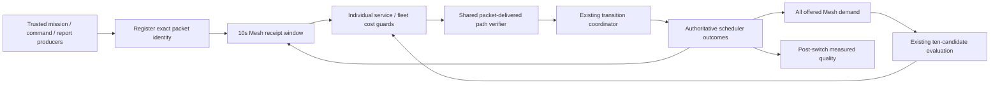

# Affected-UAV connectivity assistance

Enable **Mission → Mission setup → Prioritize affected UAVs** on a simulator service built from this source. It is off by default. Auto balanced and Auto safeguarded support it. Manual topology stays pinned. It does not enable autonomous recovery or release flight-safety actions.

The running operator services are preserved. A backend process loaded before this change needs its normal restart to expose the additive metadata; the frontend shows “Simulation service update required” when that metadata is absent. The isolated production harness verifies the new source without restarting the operator mission.

## Architecture



`simulation/swarm/uav_assistance.py` owns bounded observation buckets, registered pending identities, degradation hysteresis, target ordering, cost checks and outcomes. Candidate service estimates are populated during the existing candidate pass; there is no second ten-topology evaluation.

`simulation/swarm/route_verification.py` factors the delivered route guard out of the autonomy integration. It uses the existing registered transport, independently of local recovery controllers and flight safety. Forward and reverse packets consume real scheduler capacity and shared-radio airtime. Only Safeguarded's existing policy enables protected scheduling. Original-flow permissions, including data HOLD, are rechecked on every probe hop. A category string cannot register a packet or confer protected priority.

All ordinary and attack traffic remains in the existing radio demand estimator. Only the mission generator, registered command/acknowledgment transactions, and registered security-report fragments nominate packets for assistance. Route probes and category-spoofed traffic do not nominate themselves. A Direct-only condition cannot enter the Mesh observation window.

## Versioned policy

`affected_uav_assist_v1` uses simulation seconds throughout:

| Rule | Value |
|---|---|
| Window / evaluation | 10s / 1s |
| Completed legitimate Mesh samples | At least eight |
| Degradation | Delivery ≤80% or delivered-packet mean latency >100ms, three evaluations |
| Missing receipts | Three offers and no receipt for at least 3s, three evaluations; no round-trip-failure claim |
| Recovery | At least eight samples, delivery ≥90%, latency ≤100ms, five evaluations |
| Target gain | ≥0.10 plus changed-edge transition penalty |
| Fleet cost | Delivery ≥incumbent−0.02; latency ≤incumbent×1.10; net score ≥incumbent−0.02 |
| Another degraded UAV | Utility ≥incumbent−0.01 |
| Confirmation / cooldown | Existing three evaluations / 15s |
| Verification | Two delivered round trips per required route, ≥1s apart, within 3s |
| Captured forwarding overlap | Existing maximum 1s, packet-specific |
| Installation / failed-target backoff | Two rebuilds / 30s |

Utilities retain the configured reliability/latency/capacity weights, normalized without the efficiency term. Endpoints are weighted by offered eligible bytes. Fleet latency estimates are conditioned on modeled reachable paths; absence remains unavailable. Connectivity and protected-service guards separately prevent sacrificing currently feasible routes or Safeguarded deadlines.

Priority is missing receipts, lower delivery, higher latency, older degradation, stable identity. An endpoint with no permitted candidate route is skipped so another endpoint can be considered. Emergency connectivity recovery precedes assistance, followed by normal fleet optimization. Normal optimization also observes the degraded-UAV regression guard. Existing emergency behavior is retained when assistance is off.

## Transition sequence

```
Once per simulation second:
  reduce eligible packet outcomes in the rolling window
  update degradation / recovery confirmation counts
  reuse ten candidates and their per-flow service estimates
  if achievable connectivity is lost: apply existing emergency policy
  otherwise find the highest-priority feasible affected UAV
  reject candidates exceeding any connectivity, security or service-cost bound
  confirm challenger for three evaluations and honor the normal cooldown

When confirmed:
  keep incumbent forwarding active
  stage packet-specific target paths privately
  verify each recoverable affected endpoint's ground Mesh path
  also verify its worst eligible peer flow when present
  require two received round trips on every required path
  recheck physical permission, original-flow restrictions and cost/gain bounds
  commit through the existing coordinator at a network boundary
  retain only captured packets for at most one additional second
  validate installation on two rebuilds, or roll back and blacklist target
  report route reachability separately from subsequent measured quality
```

Disabling assistance, concurrent configuration, reset or relevant permission changes cancel pending plans. Reset/scenario loading retain the setting and clear observations. A manual topology remains pinned. Flight safety never receives an assistance override or automatic Resume. Experiments explicitly remove the setting from their copied configuration.

Diagnostics under `topology_selection.assistance` include node observations, modeled feasibility, ten bounded candidate explanations, cooldown in the parent selection object, verification progress, attempt history and realized quality. Inspect and Decisions use authoritative identities; Activity names degradation, verification and measured outcomes. Paused or stale UI evidence remains labeled.

## Exploratory protocol and reproduction

The separate `affected_uav_assist_exploratory_v1` batch comprises 48 runs: four scenarios × two policies × assistance off/on × seeds 7/42/99, 30 UAVs. Each run offers traffic for 60 simulation seconds, then drains the configured 20s TTL. A six-second fixed-tree bootstrap precedes enabling Auto at T+6s. This establishes the same incumbent in paired arms; it is not an unconstrained startup-topology study.

Primary sensor traffic is 512 bytes per ordinary UAV per second on declared parent-child flows. The designated affected sensor offers eight packets per second to a distant peer on the incumbent tree. The competing scenario uses two such sensors. UAV positions are held stationary using flight HOLD; network HOLD is separate. All identities, initial positions, primary offers and fault schedules match within each policy/seed off/on pair. Safeguarded's report workload is additional and is not claimed identical to Balanced's workload.

- Recoverable Mesh degradation: at T+8s, the declared incumbent-path Mesh edges acquire an additional 22ms modeled propagation delay until T+60s. This is an explicit per-link timing fault fixture, not a detector verdict or hardware-jamming claim. Alternative physically eligible links remain available.
- Direct-only impairment: an actual Direct spot-jam condition starts at T+8s for 52s. Mesh observations remain separate.
- Total isolation: all three target interface fixtures become unavailable at T+8s. No connectivity recovery is promised.
- Competing affected UAVs: two long peer flows share the declared Mesh timing impairment; the other degraded-UAV regression guard remains active.

```sh
venv/bin/python -m scripts.run_uav_assistance --directory results/affected_uav_assistance/new-batch --workers 2
venv/bin/python -m scripts.verify_uav_assistance --batch results/affected_uav_assistance/new-batch --directory validation/affected_uav_assistance/new-verification
venv/bin/python -m pytest -q tests/test_uav_assistance.py tests/test_adaptive_topology.py tests/test_swarm_api.py
npm --prefix frontend-react run test
npm --prefix frontend-react run typecheck
npm --prefix frontend-react run lint
npm --prefix frontend-react run build
```

The batch refuses insufficient storage and streams compressed traces. Full configuration, source archive, shared-input and offered-traffic hashes, packet outcomes and CPU timings are retained. Historical studies are not overwritten. Per-run and per-UAV exports retain individual observations. Delivered-packet latency and missing receipts are explicitly conditioned; predictions are modeled estimates, not calibrated guarantees. See `verification-report.md` for measured results and all remaining gaps.
