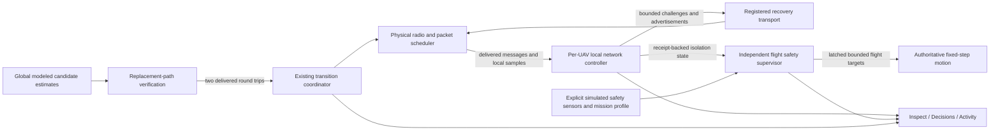

# FLARE autonomous connectivity recovery and flight safety

Autonomous recovery is an opt-in modeled network and kinematic-flight mechanism. Live Mission retains Auto balanced by default. Recovery mode is independent of topology mode and the selected resilience policy. Manual selection is still available, subject to the last-path guard while autonomy is enabled.

The operator's running services are not restarted by validation. The frontend reports that a service update is needed when connected to a backend without autonomy metadata. No hardware, autopilot deployment, navigation certification, or guaranteed physical reconnection is claimed.

## Architecture and information boundaries



`LocalNetworkController` receives immutable local frames and delivered envelopes. It has no engine, global graph, attack registry, or private state of another UAV. Its roster, initial authorized route and safety profile are provisioned before loss. Enabling requires a currently permitted control link; it cannot silently provision an already isolated UAV. Global transition state is not a local input: the controller learns about staging only through a delivered verification message, which cannot refresh ordinary liveness. Received route vectors are loop-free, sequenced and expire after three simulation seconds.

The transport adapter uses global physical state only to enforce attempted hops. Discovery does not imply a usable data route. A route becomes a recovery forwarding option after the challenge and reverse response traverse all relays. Ordinary traffic gets an expiring, captured route binding without control priority; arbitrary packets cannot borrow a registered message's permission.

The simulator's centralized topology evaluator remains a distinct source of modeled feasibility. It is not relabeled onboard knowledge. A local recovery attempt uses retained route knowledge and received neighbor vectors rather than a fresh global-graph lookup. Ground control is never an intermediate UAV relay.

Topology/component counts describe the selected modeled radio graph; interface self-test failures are also enforced during attempted packet forwarding and route measurement. Receipt-based end-to-end availability is reported separately from graph connectivity. Direct and Mesh share the terrestrial radio reservation; Satellite has modeled transport characteristics. They are communication families, not interchangeable topology names. Every family can fail. A channel label is never an immunity claim.

## State and timing

All thresholds use authoritative simulation time, including while paused and at 0.1×–4× speed.

| State | Evidence / behavior |
|---|---|
| CONNECTED | Fresh ground-control round-trip receipt |
| DEGRADED | Awaiting initial receipts or locally observed loss/queue pressure |
| SWITCHING | Replacement verification or forwarding transition in progress |
| PARTIALLY_DISCONNECTED | No fresh ground-control response, but recent authorized peer responses |
| COMPLETELY_ISOLATED | No fresh ground-control or peer response after the three-second startup/receipt budget |
| RECOVERY | Bounded attempts; underlying partial/complete health classification retained |
| RECONNECTED | Five seconds of continuous fresh exchanges after a loss |
| FAILSAFE | Ten seconds since confirmed loss, or an active independent safety latch |

Each UAV contacts at most four peers per simulation second, prioritizing recent neighbors and rotating through its provisioned roster. Additional ground-control challenges exercise Direct, Satellite and the known Mesh path. Retry backoff is one, two and four seconds, capped at four seconds. Logical channel identities include transport family, endpoints, capture time and occurrence; a Mesh response cannot shift a Satellite response draw. Registry/category names cannot grant priority; the selected protected scheduler decides service using explicit registrations.

```text
on local monitor frame:
    discard expired route advertisements
    classify local connectivity from received responses
    if disconnected:
        latch flight safety hold
        try still-authorized retained route
        try delivered neighbor route advertisement at bounded backoff
    if responses remain stable for five seconds:
        report RECONNECTED
        retain flight latch until a delivered Resume passes safety checks
```

A diagnostic requires eight observations in the local five-second window before statistical classification. Self-test failures can be explicit immediately. Missing measurements stay unknown. Diagnostic confidence scores are declared heuristics, not calibrated cause probabilities. Similar RF observations can support both temporary interference and suspected intentional jamming; equal confidence remains Undetermined rather than inventing certainty.

## Transition protocol

The incumbent graph remains active during a three-second verification stage. A normal/manual target must not partition recently verified peers or eliminate required ground-control connectivity. Target probes use registered packet-specific staging permission and current radio/security restrictions.

```text
prepare target privately
reject if it knowingly loses verified permitted connectivity
keep incumbent forwarding
send target-path challenges and reverse responses
require two successful round trips at least one second apart
if timeout or current permission changes: cancel/rollback using current conditions
otherwise commit at network boundary
retain old forwarding only for captured packets, for at most one further second
validate installation over two rebuilds
```

Snapshots distinguish the incumbent topology, requested target, verification counts, recovery-control edges, and completed topology. The overlay includes captured ordinary recovery forwarding as well as registered control probes, without granting ordinary packets protected service. The dashed overlay is not a new topology and cannot authorize unrelated data traffic. Rollback does not rewind time, completed hops, counters or packet outcomes.

## Flight safety model

Safety decisions are separate from communication recovery and DQN routing requests. The supervisor can stop mission progression, hold, return, land, or report an unresolved emergency. Networking cannot cancel landing, relaunch a grounded UAV, or bypass the latch by issuing a move/formation command.

The versioned test-range profile declares geofence, navigation confidence, obstacle-sensor availability/freshness, interface self-tests, mission criticality, landing areas and obstacle fixtures. Homes are captured at mission initialization, even when autonomy is enabled later, and checked against the actual heightfield, declared obstacles and geofence. Visual scenery does not establish obstacle coverage or a landing site.

Normal motion retains its acceleration, turn, separation and terrain-floor constraints. Authorized landing can descend below the airborne terrain floor at no more than one metre per second. Terrain elevation remains unchanged; negative local ground coordinates are valid. A grounded outcome is successful only after the declared footprint and controlled touchdown checks pass.

After confirmed control loss, the supervisor holds while recovery runs. After ten seconds, it chooses a feasible home/declared landing route only with navigation confidence at least 0.8, fresh obstacle evidence, geofence compliance and modeled reserve. At critical battery, landing takes priority. Routine missions prefer a feasible home; critical missions use the nearest feasible declared site to reduce exposure. Mission criticality never permits violating safety constraints.

When safety evidence or a feasible site is absent, the outcome remains unresolved. Battery exhaustion enters uncontrolled descent and unsafe ground contact accounting, not a fabricated safe landing. Battery states explicitly distinguish normal, caution (20%), critical (10%) and emergency (5%). The energy estimate uses existing simulator consumption units and is explicitly uncalibrated. A landing still in progress at the 180-second measurement boundary is reported separately from completed landings and infeasible-site constraints.

Profile changes are requested through the authenticated revision-checked configuration endpoint and reach active onboard profiles only after a packet is delivered. Explicit null navigation/sensor inputs remain unavailable. Turning autonomy off stops new recovery decisions but retains an active safety latch and the liveness needed to authorize Resume.

## Compatibility and validation

Existing A/B, fixed benchmarks and previous adaptive studies explicitly strip live autonomy settings. Historical results are not rewritten. The separate recovery batch pairs initial inputs and fault schedules only; safety-driven flight trajectories are endogenous and are not claimed identical.

The ten recovery presets are available in Mission Setup. The validation protocol runs all ten with 30 UAVs, seeds 7/42/99 and autonomy off/on: 60 runs, 180 simulation seconds plus the configured packet TTL drain. Flight/liveness measurements end at 180 seconds; the drain retains complete packet accounting and is excluded from safety-onset claims.

See the accompanying verification report for actual Passed, Failed, Blocked and Not Tested outcomes, retained development failures, source identities, measurements and remaining limitations.

## Configuration assumptions and failure examples

The default test-range footprint is five metres, with a maximum five-degree sampled landing slope, five-metre obstacle clearance, and ten-metre landing occupancy exclusion. Nearby observations are explicit simulated obstacle-sensor fixtures within 100 metres. These bounds are modeled choices, not certified sensing guarantees. Geofence edits validate the current fleet and proposed formations before mutation. Initial profiles are provisioned before loss; later active profiles are applied on a registered packet receipt, including explicit null values.

Control-message size is modeled as a 128-byte header plus 32 bytes per route identity, with the encoded profile added when present. Messages expire before the three-second receipt boundary. They use real queue, retry, TTL, shared-radio and capacity checks; the byte model is not an on-air protocol implementation.

- A proposed Ring that loses a verified permitted path is rejected before publishing it. A candidate with missing return probes times out, retaining the incumbent under current permissions.
- Loss of all three interfaces leaves the controller isolated even if the global graph contains a geometric route. Recovery does not move the UAV to hunt for radio coverage.
- Reconnection reports five seconds of stable exchanges but keeps safety hold/return latched. An operator Resume must arrive and pass current safety checks. Landing cannot be cancelled.
- Unknown navigation or stale obstacle evidence prevents an invented safe return. Occupied/invalid sites remain unavailable. Battery exhaustion and uncommanded terrain contact are unsafe outcomes.
- A manual management revocation immediately blocks packet forwarding, including packets that already completed an earlier hop. Earlier delivered observations remain history, not current permission.

```sh
venv/bin/python -m pytest -q
npm --prefix frontend-react test
npm --prefix frontend-react run typecheck
npm --prefix frontend-react run lint
npm --prefix frontend-react run build
FLARE_TEST_PRODUCTION=1 npm --prefix frontend-react run test:browser
venv/bin/python -m scripts.run_autonomous_recovery --directory results/autonomous_recovery/new-validation --workers 2
venv/bin/python -m scripts.verify_autonomous_recovery --directory results/autonomous_recovery/new-validation
venv/bin/python -m scripts.summarize_autonomous_recovery --directory results/autonomous_recovery/new-validation --output results/autonomous_recovery/new-summary
```

An interrupted batch can be resumed only with the same source fingerprint using `scripts.resume_autonomous_recovery`. Incomplete traces are retained separately. Source repairs require a new batch rather than relabeling previous measurements.
